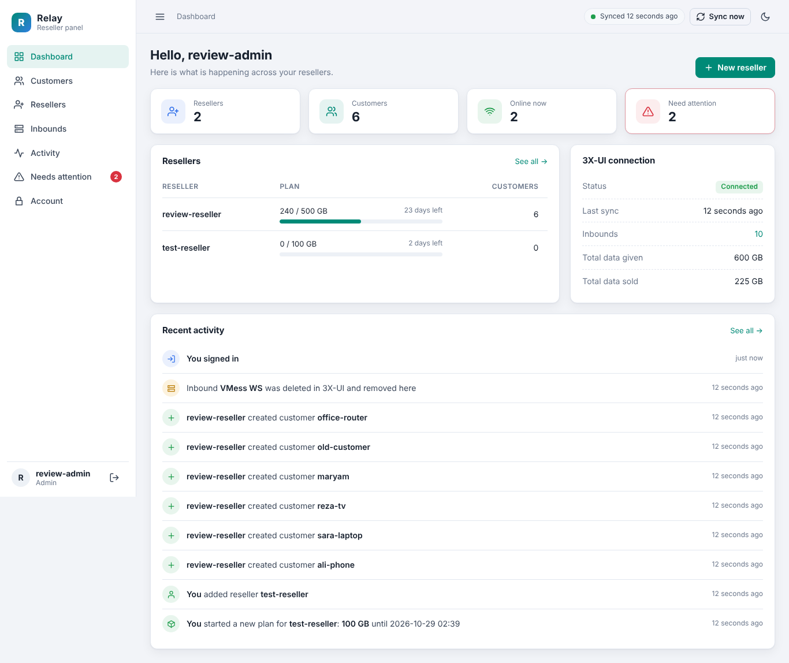
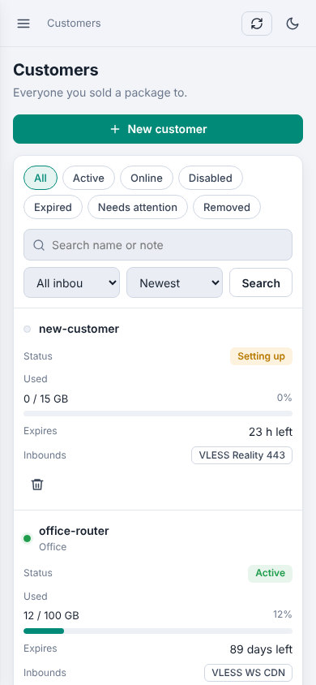

# Relay — reseller panel for 3X-UI

[](https://github.com/mohammad1453/Relay-Panel/releases)
[](https://github.com/mohammad1453/Relay-Panel/actions/workflows/ci.yml)

Relay adds **resellers** to [3X-UI](https://github.com/MHSanaei/3x-ui). You give each reseller a plan (for example 500 GB until the end of the month) and a set of inbounds. They sign in to their own panel and create, edit and delete customers. Every sale is taken from their plan. 3X-UI keeps doing the VPN work; Relay never changes your inbounds or 3X-UI settings.



## Features

- **Resellers with plans:** data size, end date and allowed inbounds per reseller. Renew, change or suspend at any time.
- **Customers:** create in a few clicks with data limit, fixed date or "days from first connection", note, and one or more inbounds. Subscription link and per-inbound config links with copy buttons.
- **Stays in sync with 3X-UI** every 30 seconds: usage, online status and expiry. Inbounds or customers deleted in 3X-UI disappear from Relay too.
- **Change many customers at once:** add, remove or move inbounds (or turn customers on/off) for selected customers or a whole filtered list, with a preview before anything changes.
- **Settings page:** set your subscription address once (e.g. `https://sub.example.com/i/`); every customer gets their own link.
- **3X-UI wins:** change a customer directly in 3X-UI and Relay copies it right away, free for the reseller. You and the reseller are told what changed, and you can undo it for 7 days. Prefer to approve each change? Choose **Ask me first** in Settings.
- **Needs attention** page for the admin: anything Relay could not finish, explained in plain words with the right buttons.
- **Telegram bot:** alerts for the admin and each reseller, with buttons to approve requests, accept 3X-UI changes, turn customers on or off and more. See [docs/TELEGRAM.md](docs/TELEGRAM.md).
- **Requests for more data:** resellers ask from their dashboard or the bot; the admin approves or declines with one click.
- **Readable activity log** for admins and resellers ("You created customer ali-phone", "Inbound VMess WS was deleted in 3X-UI").
- **Safe accounting:** quota is held while 3X-UI confirms a change and only counted once it is verified.
- Dark and light theme, works on phones, English interface.

<p align="center"></p>

## Requirements

- A VPS with **Debian 12/13** or **Ubuntu 22.04 / 24.04 / 26.04**, x86_64 or arm64, with root access.
- **3X-UI, any version from 2.x to the newest 3.x.** Relay detects which API your panel has; on 3.1 and newer every feature works, on 2.x/3.0 each customer gets one inbound. See [3X-UI compatibility](docs/API.md).
- A 3X-UI admin **API token** (recommended), or the 3X-UI admin username and password (without 2FA).

## Install

Run this on the VPS as root:

```bash
bash <(curl -Ls https://raw.githubusercontent.com/mohammad1453/Relay-Panel/main/install-online.sh)
```

It downloads the latest [release](https://github.com/mohammad1453/Relay-Panel/releases), checks its SHA-256, and starts the installer. Use the `bash <(curl ...)` form shown above (not `curl ... | bash`), because the installer asks you questions:

| Question | What to enter |
|---|---|
| Application URL | The address you will open Relay at, e.g. `https://relay.example.com` (see the options below) |
| 3X-UI panel address | The 3X-UI address **including its web path**, e.g. `http://127.0.0.1:2053/your-web-path/` — see the note below |
| Original panel SQLite paths | Where 3X-UI keeps its database, usually `/etc/x-ui/x-ui.db` |
| Public subscription base URL | Your subscription address without the customer ID, e.g. `https://sub.example.com/i/`. Leave empty to hide subscription links |
| Master admin API token | An admin API token created in 3X-UI's settings. Leave empty to use the 3X-UI username and password instead |
| Administrator username / password | The first Relay admin account. You change the password at first sign-in |

### Relay and 3X-UI on the same VPS (most common)

When both run on the same server, Relay should talk to 3X-UI over **127.0.0.1** instead of the public IP:

```text
✅  http://127.0.0.1:2052/x-ui/
❌  http://203.0.113.5:2052/x-ui/
```

Relay only allows plain `http://` to 3X-UI on 127.0.0.1, because nothing leaves the server there. From version 1.0.0, **the installer does this for you**: if you type the public IP address of this VPS, it switches to `127.0.0.1` with the same port and path, and keeps the public address for the customer links. If you already have Relay installed and see the error *"XUI_URL requires HTTPS"*, change `XUI_URL` in `/etc/3xui-reseller/app.env` to `http://127.0.0.1:PORT/WEB-PATH/` and run `sudo systemctl restart xui-reseller`.

If 3X-UI runs on **another** server, use its `https://` address.

### Ways to open the panel

```bash
# Recommended: your own domain with HTTPS through an existing Nginx and certificate
bash <(curl -Ls https://raw.githubusercontent.com/mohammad1453/Relay-Panel/main/install-online.sh) \
  --origin https://relay.example.com --domain relay.example.com \
  --tls-cert /path/to/fullchain.pem --tls-key /path/to/privkey.pem

# Like 3X-UI: http://VPS_IP:PORT/secret-path/ (plain HTTP; limit access with your firewall)
bash <(curl -Ls https://raw.githubusercontent.com/mohammad1453/Relay-Panel/main/install-online.sh) \
  --public-http --origin http://VPS_IP:8095/relay-secret/ --port 8095

# Private: only through an SSH tunnel
bash <(curl -Ls https://raw.githubusercontent.com/mohammad1453/Relay-Panel/main/install-online.sh) \
  --tunnel-http --origin http://localhost:8095 --port 8095
```

To install a specific version, add `--version v1.0.0`. If the server cannot reach GitHub or pypi.org directly (for example in Iran), add `--proxy http://127.0.0.1:10808`; see [Installing behind a proxy](docs/INSTALL.en.md#installing-behind-a-proxy). Full details: [installation guide](docs/INSTALL.en.md).

## Update

Run the same command again. If Relay is already installed it **updates** instead: it makes a backup, installs the new version, upgrades the database and checks that Relay starts. If anything fails it rolls back by itself. Your resellers, customers and settings are kept.

```bash
bash <(curl -Ls https://raw.githubusercontent.com/mohammad1453/Relay-Panel/main/install-online.sh)
```

After updating from 0.1.0, read [docs/UPGRADE.md](docs/UPGRADE.md) for the two new settings.

## Everyday commands

```bash
sudo bash /opt/3xui-reseller/status.sh      # version, service status and 3X-UI connection check
sudo bash /opt/3xui-reseller/backup.sh      # backup to /var/backups/3xui-reseller/
sudo bash /opt/3xui-reseller/restore.sh --archive /var/backups/3xui-reseller/relay-....tar.gz
sudo systemctl restart xui-reseller         # restart Relay (3X-UI is not touched)
sudo journalctl -u xui-reseller -n 100      # logs
```

Forgot the admin password:

```bash
cd /opt/3xui-reseller && sudo -u xui-reseller .venv/bin/python -m reseller.manage reset-password --env /etc/3xui-reseller/app.env
```

## Uninstall

```bash
bash <(curl -Ls https://raw.githubusercontent.com/mohammad1453/Relay-Panel/main/install-online.sh) --uninstall
```

This removes the Relay program and service but keeps its database, settings and backups. Add `--purge-data` to delete those too. 3X-UI and its clients are never touched.

## Versions

Relay uses [semantic versioning](https://semver.org/). The current version is shown at the bottom of the sidebar and on the sign-in page. See the [changelog](CHANGELOG.md) for what changed in each version, and [docs/RELEASING.md](docs/RELEASING.md) for how releases are made.

## Documentation

- [Installation guide](docs/INSTALL.en.md) · [راهنمای نصب فارسی](docs/INSTALL.fa.md) (installation only; the panel is in English)
- [Upgrading from 0.1.0](docs/UPGRADE.md)
- [Telegram bot](docs/TELEGRAM.md)
- [How Relay works and recovers](docs/ARCHITECTURE.md)
- [3X-UI compatibility and API](docs/API.md)
- [Security and known limits](docs/VERIFICATION.md)

## Development

Python 3.10 or newer.

```bash
python3 -m venv .venv
.venv/bin/pip install -r requirements-dev.txt -c requirements.lock
.venv/bin/python -m pytest -q
.venv/bin/python tools/preview_fixture.py   # demo panel with test data on http://127.0.0.1:8095
```

Demo logins: `review-admin` and `review-reseller`, password `A-long-test-password!`.

Project layout:

| Path | What it is |
|---|---|
| `reseller/domain.py` | Plans, customers, quota accounting and sync with 3X-UI |
| `reseller/xui.py` | 3X-UI connection (detects client API or classic API) |
| `reseller/web.py`, `templates/`, `static/` | Web panel |
| `reseller/telegram.py` | Telegram bot: alerts, commands and buttons |
| `reseller/activity.py` | Turns logs into readable sentences |
| `reseller/security.py` | Passwords, sessions, rate limits |
| `deploy/ops.py` | Install, update, backup, restore, uninstall |
| `install-online.sh` | Online installer used by the command above |
| `tests/` | Automated tests (no real 3X-UI needed) |
